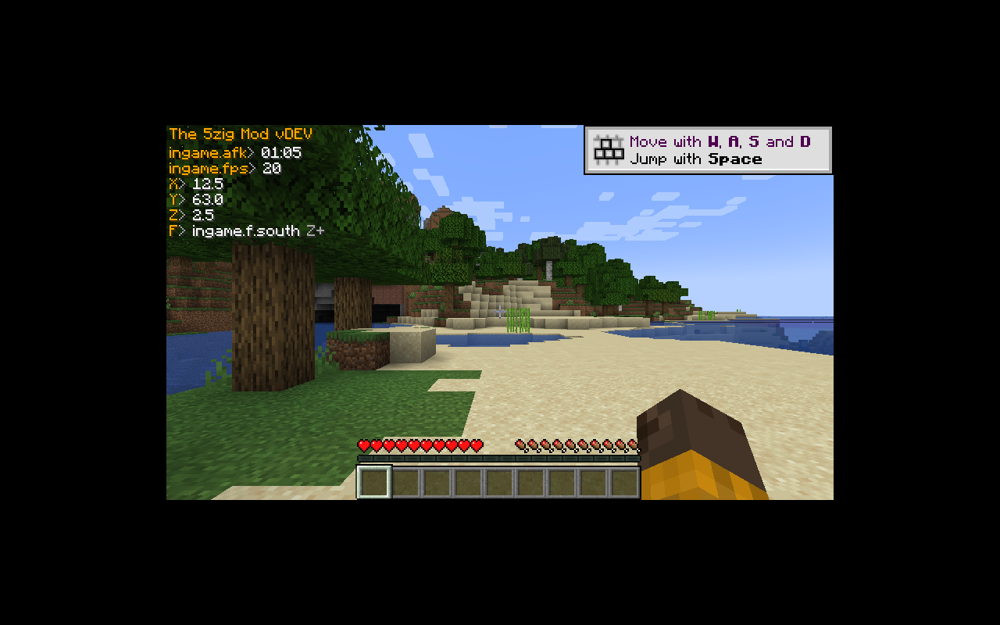

<p align="center">
  
</p>

<h1 align="center">5zig Renewed</h1>

The 5zig Mod, renewed for Minecraft 1.16 – 26.3 on **Fabric**, **NeoForge** and **Forge**.

5zig died at 1.15.2 (last upstream commit: July 2022). This is a continuation that keeps the mod's
design — the HUD module system, capes, friends/chat, server ping, plugin API — and rebuilds the
Minecraft-facing layer for every version since.

> Not affiliated with Mojang, Microsoft, 5zig or 5zig Reborn. GPL-3.0, same as upstream.

## How the port works

Upstream is unusually friendly to porting: `eu.the5zig.mod.*` (≈70k LOC) contains **zero
`net.minecraft` imports**. All Minecraft access is funnelled through a platform layer:

| Layer | Upstream | Here |
|---|---|---|
| Core (config, modules, HUD layout, chat/friends protocol, server API) | `The-5zig-Mod/mod` | `core/` — unchanged |
| Platform contract | `version-support/1.15.1/Variables.java` + `gui/elements/*` | `eu.the5zig.mod.util.IVariables` (162 methods) |
| Platform impl | 56 classes + 24 mixins **per Minecraft version** | `platform/<mc>/` |
| Loader glue | Forge `@Mod` + ASM name tables | `loader/{fabric,neoforge,forge}/` |

The 56-class platform layer is ~7.6k LOC per version, so it is grouped into **10 eras** (API
breakpoints, not every patch) and shared across the versions inside an era. That turns 120
version×loader artifacts into 10 platform implementations + 3 loader adapters.

Eras and the per-version matrix: [`docs/version-matrix.md`](docs/version-matrix.md).
Port conventions and verified 1.20.1 signatures: [`docs/port-spec.md`](docs/port-spec.md).

## Status

| Target | State |
|---|---|
| **1.20.1 Fabric** | **build green + client-verified** — mod loads, HUD renders in-world |
| **1.20.1 Forge** | **build green + client-verified core** — mod loads, core inits in ~250-540 ms, 12 keybinds register, both mixin configs apply; the overlay does not draw yet |
| 1.20.1 NeoForge | build config in place; NeoGradle 7 hands out SRG-named 1.20.1 classes, so the platform needs the `official` mappings channel — queued |
| 1.21.1, 1.21.x, 26.x | queued (eras E7–E10) |
| 1.16 – 1.19 | queued (eras E1–E4), backfill |



Verified in real clients (Xvfb + llvmpipe, headless): Fabric renders FPS, coordinates, facing and the
AFK timer; Forge initialises the same core and registers the same bindings.

### What is left on Forge

`ForgeGui extends Gui` and overrides `Gui#render`, so the platform's `@Mixin(Gui)` hook never runs
there. `loader/forge/.../MixinForgeGui` targets the override and applies (confirmed in the log), but
the overlay still does not appear — the next step is to trace whether `HudFrame.begin` is reached and
what the core's `GuiIngame` reports at that point.

### Known gaps in this build

- the mod menu key (**M**) does not open the GUI on either loader yet
- capes, 2nd chat, server ping and the friends/chat backend are wired but not exercised against live servers
- Discord Rich Presence, TeamSpeak and the iTunes/WMP bridges are inert on Linux
- dependencies (DiscordIPC, sqlite, jacob, json, netty-http) are on the dev classpath but not yet
  jar-in-jar'd, so the release jars are not yet self-contained

## Building 1.20.1 Fabric

```bash
./gradlew build          # needs JDK 17+ (1.20.1 compiles to Java 17)
./gradlew runClient      # dev client
```

Source layout is wired through `sourceSets` in `build.gradle`; a version module only differs by
`minecraft_version`, the loader dependency and the `platform/<era>` source dir.

## Dropped from upstream

These were tied to the 1.15 Forge/launchwrapper world and do not exist in a loader-packaged mod:

- the self-updater and the GUI installer (`Updater`, `installer/`, `Start`)
- the ASM transformer + obfuscation name tables → replaced by mixins
- `5zig-fabric` (a runtime Jar remapper to run the Forge build on Fabric) → native Fabric build now

## License

GPL-3.0. Original work © 5zig, 5zig Reborn contributors. See `LICENSE`.
